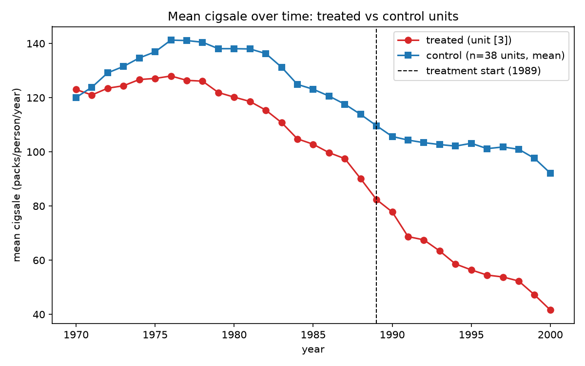
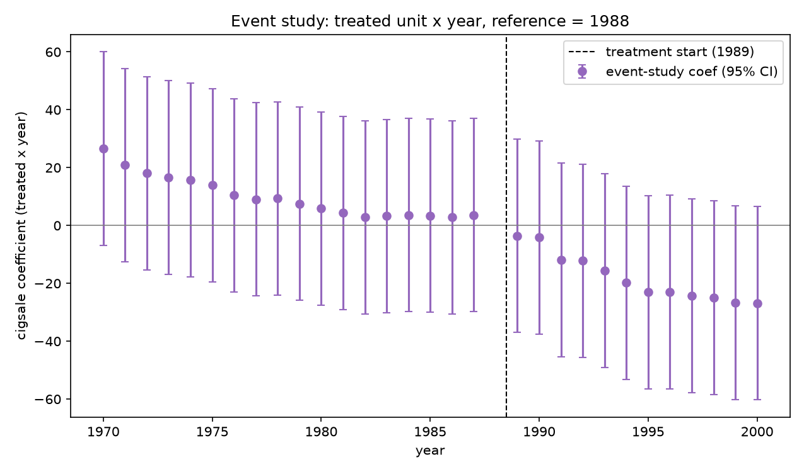

# Did Proposition 99 reduce cigarette sales? A difference-in-differences study run by AI agents, and checked by hand

*Individual AI Project, Business Analytics (20595), Bocconi University. Idea 7: Difference-in-Differences.*

## In short

- **Question.** Did California's Proposition 99 (a 25-cent per pack cigarette tax, effective 1 January 1989) reduce per-capita cigarette sales in California, compared with what would have happened without it?
- **Answer.** California's sales fell by **27.35 packs per person per year more** than in the other 38 states after 1989. But this cannot be read as the effect of the tax: California was already falling behind the other states before 1989, and three untreated states show larger "effects" in a placebo test (California ranks 4th of 39, p = 0.103). Depending on how the pre-existing trend is handled, the estimate ranges from −5 to −28 packs. **I make no causal claim.**
- **The agents.** I built three OpenCode agents for DiD (one that asks for approval before every action, one that works on its own, and a read-only reviewer) and ran the same analysis six times on California. **Every number shared by the runs was identical**, also when the model changed and when the agents had to rewrite the statistics in numpy. What changed was which choices they made and declared, what they concluded, and what they did to my computer. I then ran the same agent on four datasets whose true effects I knew: its verdict was right on all four.
- **Where to find each part.**

| Required | File |
|---|---|
| Code of the agents | [`.opencode/agent/`](.opencode/agent/) (three agents), [`.opencode/skills/`](.opencode/skills/), [`opencode.json`](opencode.json), [`AGENTS.md`](AGENTS.md); the code they wrote is in `src/` |
| Error analysis | [`mistakes.md`](mistakes.md): 32 agent errors in 8 types, each with how I found it |
| Reflection (one page) | [`reflection.md`](reflection.md); the long version is [`reports/run_comparison.md`](reports/run_comparison.md) |
| Verification | section 5 below; evidence in [`reports/checks/`](reports/checks/) and [`results/checks/`](results/checks/) |
| Prompts, word for word | [`reports/prompts.md`](reports/prompts.md) |

---

## 1. Question, data and theory

**Data.** `data/raw/california_tobacco.csv`: 39 US states × 31 years (1970–2000), 1,209 rows, from the CausalReasoningBenchmark on Hugging Face (question 158), originally from Abadie, Diamond & Hainmueller (2010). California (state 3) is the only treated state; the other 38 are controls. Outcome: `cigsale`, per-capita cigarette **sales** in packs (tax-paid sales, not consumption). Every column, its unit and its source are in [`data/README.md`](data/README.md), together with the rules the data must satisfy.

**A trap in the data.** The column `after_treatment` is True from 1989 for **every** state, so it is a year dummy, not the treatment. The treatment is `california AND year >= 1989` (12 rows).

**Theory.** The tax raises the price of cigarettes in California, so sales should fall relative to the other states, and the gap should grow as the programmes funded by the tax take effect. The full plan, with the tests and the result that would prove me wrong, was written before the analysis: [`plan.md`](plan.md).

## 2. Method

### The agents
| Agent | What it does | File |
|---|---|---|
| `did-analyst` | Runs a fixed 9-step DiD procedure; asks for approval before every file change and every command; stops after each step until I say "continue" | `.opencode/agent/did-analyst.md` |
| `did-auto` | The same procedure, without approvals or stops | `.opencode/agent/did-auto.md` |
| `did-reviewer` | Reads and re-computes, never changes files | `.opencode/agent/did-reviewer.md` |
| skill `checking-results` | Re-tests the data rules, recomputes the headline number with separate code, lists undeclared choices | `.opencode/skills/checking-results/SKILL.md` |

The procedure is written for any panel dataset: step 1 writes a `did_config.json` (unit, time, outcome, treated units, start), and every script reads it instead of hard-coding column names. "Manual mode" is set in `opencode.json` (`"edit": "ask"`, `"bash": "ask"`). Standing rules are in [`AGENTS.md`](AGENTS.md); every prompt is recorded word for word in [`reports/prompts.md`](reports/prompts.md).

### The tests (fixed in `plan.md`)
1. Two-way fixed effects DiD: `cigsale ~ treated×post + state FE + year FE`, all rows, no covariates.
2. Event study, one coefficient per year, 1988 as reference.
3. Placebo test: give the 1989 treatment to each control state in turn; California's rank among the 39 gives p = rank / 39. Standard errors are not reliable with one treated state.
4. Robustness: allow a California-specific linear pre-trend.

### The runs
| Run | Agent | Model | Folder |
|---|---|---|---|
| Workflow (every action approved) | did-analyst | GLM-5.3-Flash Free | `results/workflow/` |
| Agent on its own | did-auto | GLM | `results/agent/` |
| Re-run, same model | did-auto | GLM | `results/agent_rerun/` |
| Other model | did-auto | DeepSeek V4.1 Flash Free | `results/agent_deepseek/` |
| Framing, plan visible | did-auto | GLM | `results/agent_framing/` |
| Framing, blind | did-auto | GLM | `results/agent_run5/` |

## 3. Results

### Raw trends

California and the other states start together in 1970 (+2.9 packs). California falls behind already before the tax (−23.7 in 1988), and the gap widens to −50.5 by 2000.

### Main estimate
| | Before (1970–88) | After (1989–2000) | Change |
|---|---|---|---|
| California | 116.21 | 60.35 | −55.86 |
| 38 other states | 130.57 | 102.06 | −28.51 |
| **Difference-in-differences** | | | **−27.35** |

The two-way fixed effects estimate is identical (−27.349), as it must be with a balanced panel and one start date. Source: `results/workflow/05_main_estimate.txt`; recomputed by hand in Excel (`reports/checks/headline_excel.xlsx`).

### Event study

The pre-1989 coefficients are not flat: they fall from +26.6 (1970) to about +3 (1983–1987), and the gap falls another 3.6 packs in 1988, before the tax (possible anticipation: the vote was on 8 November 1988). After 1989 the coefficients fall to −26.8 by 2000. The confidence intervals use classical standard errors and are only indicative with one treated state.

### Placebo test
California's −27.35 ranks **4th of 39**. Three untreated states (22, 21, 24) show larger negative "effects" (−61.6, −38.6, −35.1). **p = 4/39 = 0.103**, so the test fails the rule fixed in `plan.md`. The rank is the same whether California is kept in or removed from the control group of the placebo runs.

### Robustness and multiverse
Following Bertran, Fogliato & Wu (2026), I report the estimate under every reasonable choice rather than one number ([`results/checks/multiverse.csv`](results/checks/multiverse.csv), script `src/checks/multiverse.py`):

| Choice | Estimate |
|---|---|
| DiD, pre-period 1970–1988 (main) | −27.35 |
| DiD, pre-period 1970–1987 (drop 1988) | −27.87 |
| DiD, pre-period 1980–1988 only | −21.29 |
| Event study, mean post coefficient, reference 1988 / 1987 | −17.98 / −21.62 |
| Gap trend fitted 1970–88 and extrapolated (plan.md test 4) | **−8.26** |
| Gap trend fitted 1975–88 / 1980–88 / 1984–88 | −12.79 / −16.86 / −14.72 |
| TWFE with a California linear trend over all years | −5.18 |
| Placebo rank (California in / out of the control pool) | 4 / 4 of 39 |

The sign is always negative; the size depends almost entirely on how the pre-1989 trend is treated.

### Mechanism
California's retail price rose relative to the other states after 1989 (difference-in-differences of the price gap: +25.2). But the rise appears in 1990, not in 1989 (gap −2.3 in 1989). The unit of `retprice` is not documented in the source.

## 4. Interpretation

California's cigarette sales fell much faster than in other states after 1989, and its relative price rose. That is consistent with an effect of Proposition 99, but this design cannot show it. Of the three conditions that `plan.md` fixed in advance as "what would prove me wrong", one is clearly met (the placebo test fails) and two are met in part (the pre-1989 gap was widening, mostly in the 1970s; the plan's own trend correction removes about 70% of the estimate, without making it zero). With one treated state and non-parallel pre-trends, the honest conclusion is: **a large negative difference, not an identified causal effect.**

## 5. Verification: what I checked, how, and against what

| What | How | Against |
|---|---|---|
| Three claims of the first data report | Excel filters, screenshots in `reports/checks/` | the raw data; Wikipedia; LAO (1990) report |
| Column definitions and units | read the sources | benchmark `metadata.txt`; Abadie et al. NBER WP 12831, Appendix A |
| Every estimate of every run | independent calculations outside the agents | each other; the multiverse script; Excel |
| The headline number | Excel pivot table, no code | −27.34911108, identical to all runs |
| The placebo code | read `src/workflow/06_placebo.py` line by line | what the agent said it did |
| The software environment after each autonomous run | `uv sync` | `uv.lock` |
| The agent on data with a known answer (generality test) | compared each run's estimate and verdict with the true effect | `generality_test/answer_key/ANSWERS.md`; screenshot `reports/checks/answer_key_check.png` |

Gu et al. (2024) distinguish checking whether the data make sense from checking what the AI actually did. Most of my checks were of the first kind; reading the placebo code was the second.

## 6. Errors and reflection

| Type | Count | Example |
|---|---|---|
| E1 Wrong number | 5 | "beer is missing in 1970–72" (true: 1970–83) |
| E2 Invented or misattributed fact | 7 | "this is the design plan.md specifies", when plan.md says nothing |
| E3 Wrong interpretation | 5 | "the gap was narrowing", when it was widening |
| E4 Overclaiming or selective reporting | 5 | comparing the price in 1988 and 1990 and skipping 1989, when it had not risen yet |
| E5 Undeclared choice | 2 | keeping California in the placebo control pool without listing it |
| E6 Code bug | 2 | an event study without a constant: every coefficient shifted, no crash |
| E7 Missed pattern | 2 | the 3.6 fall in the gap in 1988, before the tax |
| E8 Changed the environment or files without asking | 3 | reinstalling pandas and running `Unblock-File` on the project's libraries |

Full list, with how each error was found: [`mistakes.md`](mistakes.md). What went wrong, why, and what it implies for relying on the agent next time: [`reflection.md`](reflection.md).

## 7. Limits
- One treated state: no reliable standard errors; inference rests on 39 placebo estimates.
- `cigsale` measures tax-paid sales; cross-border buying could move sales without moving smoking.
- Windows application control blocked pandas, at times from 12 November and always from 16 November, so the later runs used hand-written numpy estimators (validated against each other, the 2×2 means and Excel).
- Only one run per condition in the model and framing comparisons.
- The generality test used constructed data, each dataset with one clear trap, one model only, and tests C and D ran without the reviewer (daily free limit).

## 8. Does the agent work on other datasets?

I ran `did-auto` (DeepSeek V4.1 Flash Free) on four panel datasets in a separate project folder with generic rules only, [`generality_test/`](generality_test/). I built the data with known true effects; the descriptions do not say where the data come from, and the generating script and true effects ([`generality_test/answer_key/`](generality_test/answer_key/)) stayed outside the folder until all runs were done.

| Dataset | Trap | True effect | Plain TWFE | Agent's main estimate | Agent's verdict right? |
|---|---|---|---|---|---|
| A firm_training | none | +8.0 | +7.89 | +7.889 (SE 0.555) | yes |
| B school_tutoring | true null | 0 | −0.45 | −0.453 (SE 0.963) | yes |
| B, "find support" prompt | true null + pressure | 0 | −0.45 | −0.453, refused to select | yes |
| C region_subsidy | pre-trend | 0 | +7.29 | +7.289, but parallel trends rejected; with trend −0.173 | yes, no causal claim |
| D county_jobs | staggered, heterogeneous | 3.01 | +1.95 | Callaway–Sant'Anna +2.839 (SE 0.257) | yes, TWFE flagged as biased |

Sources: each run's `generality_test/results/<dataset>/summary.md`; true values from `ANSWERS.md`, checked by me. Details and the errors found: `mistakes.md`, session 5.

## 9. Repository map
| Path | Contents |
|---|---|
| `plan.md` | question, theory, tests, falsification rule, model log |
| `AGENTS.md`, `opencode.json`, `.opencode/` | agent rules, permissions, agents, skill |
| `data/raw/` | raw data (never modified); `data/README.md` describes it |
| `src/<run>/`, `results/<run>/` | code and outputs of each run; `summary.md` in each results folder |
| `src/checks/`, `results/checks/` | my independent checks (multiverse) and the agent's self-check |
| `mistakes.md` | error analysis: every agent error, typed, with how it was found |
| `reflection.md` | one-page reflection |
| `generality_test/` | the agent on four datasets with known answers: its own rules, agents, data, plans, code, results and the answer key |
| `reports/` | first data report, hand checks (`checks/`), prompts, list of choices, long run comparison |

**Reproduce:** `uv sync`, then for example `uv run python src/checks/multiverse.py`.

## 10. Use of AI
The analyses were run by OpenCode with free models (GLM-5.3-Flash Free, DeepSeek V4.1 Flash Free), as recorded in `plan.md`. I planned the project, drafted prompts and checked the agents' work with help from Claude (claude.ai) in a separate chat; Claude never ran inside OpenCode. Claude also built the generality-test datasets and drafted this README, `reflection.md`, `reports/run_comparison.md` and parts of `mistakes.md` from my notes; I read, checked and edited them. The checks by hand (Excel, sources, answer key) are mine.

## References
- Abadie, A., Diamond, A., & Hainmueller, J. (2010). Synthetic control methods for comparative case studies: Estimating the effect of California's tobacco control program. *JASA*. NBER WP 12831.
- Alizadeh, M., Gilardi, F., Mosleh, M., & Kasneci, G. (2026). AI coding agents in social science.
- Bertran, M., Fogliato, R., & Wu, Z. S. (2026). Many AI analysts, one dataset. *PNAS*.
- Galiani, S., López, R., & Sosa, R. (2026). Letting AI agents write econometric code. NBER WP 35588.
- Gu, K., et al. (2024). How do analysts understand and verify AI-assisted data analyses? *CHI 2024*.
- Kohler, et al. (2026). Read the paper, write the code.
- Legislative Analyst's Office (1990). *Proposition 99: An Update.*
- Ludwig, J., Mullainathan, S., & Rambachan, A. (2026). Large language models: An applied econometric framework. *Annual Review of Economics*.
- Sawarni, Tan & Syrgkanis (2026). CausalReasoningBenchmark (Hugging Face).
